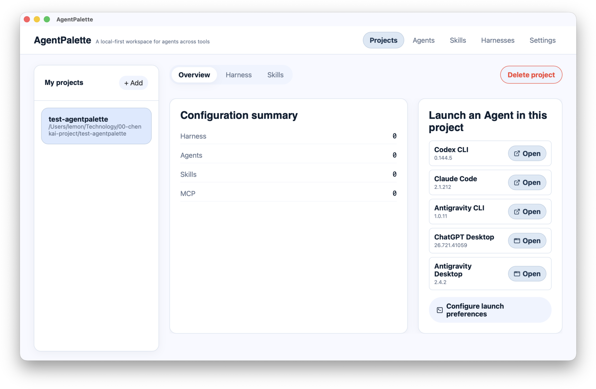
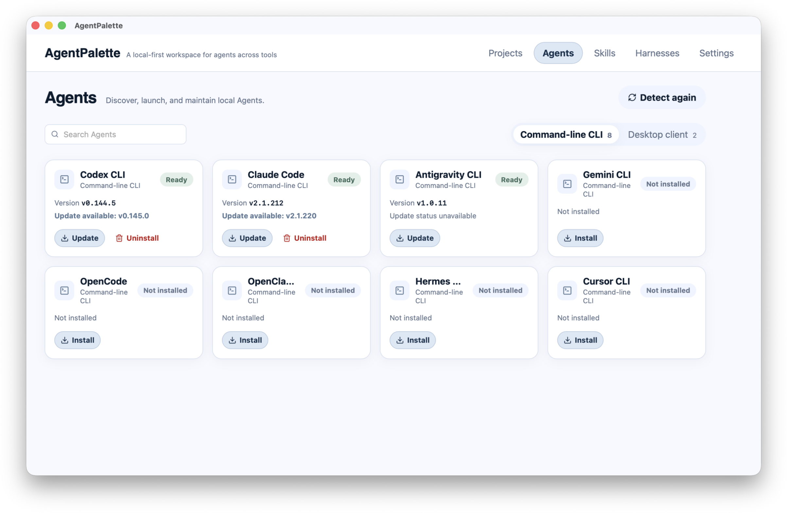
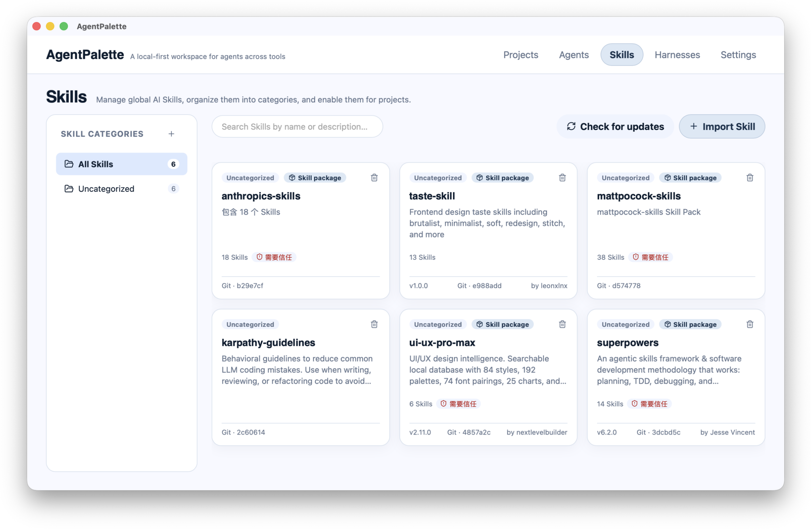
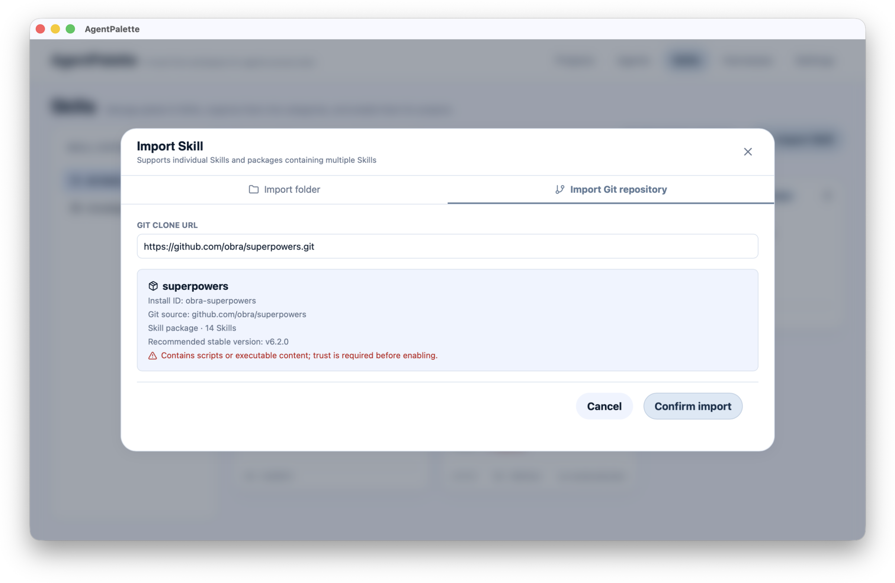
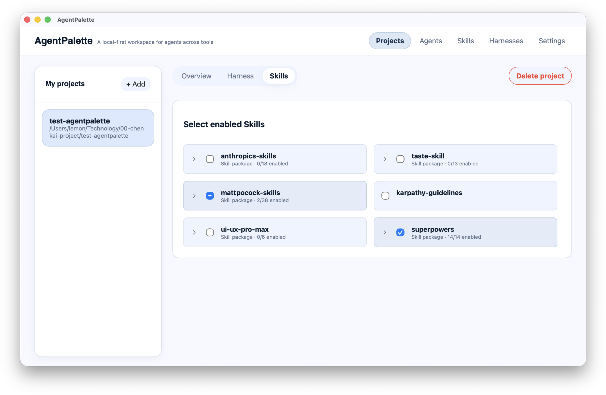
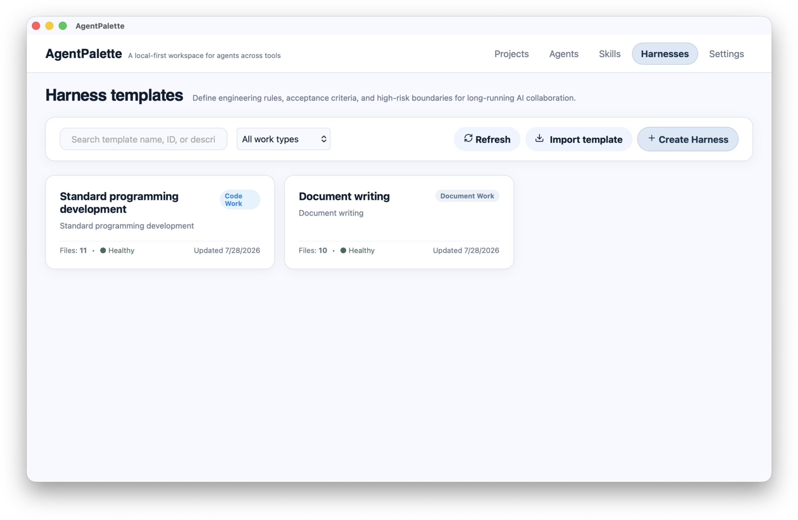
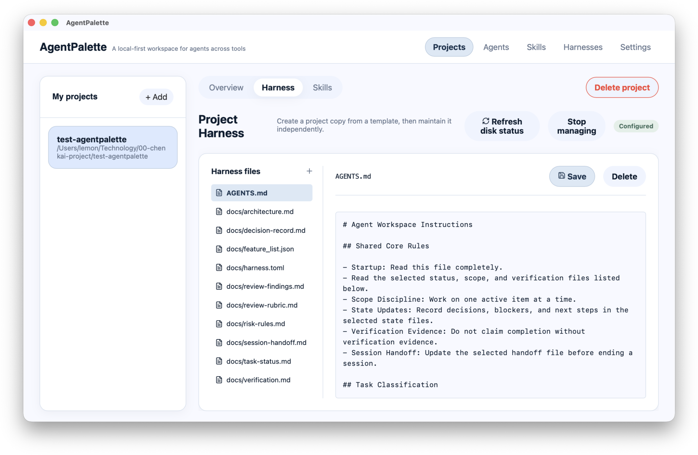
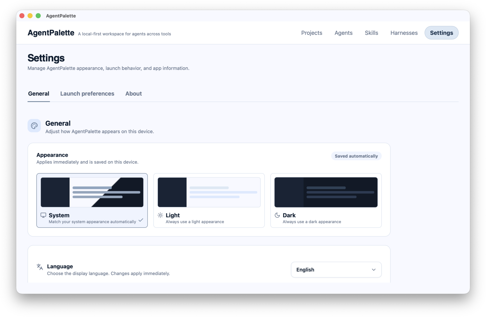

# AgentPalette

English | [简体中文](./README.zh-CN.md)

> A local-first workspace manager for AI agents across tools and projects.

AgentPalette is a desktop application for managing local AI agents, Skills, and Harnesses in one place, then applying the right capabilities to each project. Project configuration and Skill libraries stay on your machine; the app never copies your project directories.

[Download the latest release](https://github.com/Aimny2020/agentpalette/releases/latest) · [Report an issue](https://github.com/Aimny2020/agentpalette/issues) · [Contribute](./CONTRIBUTING.md)

## Contents

- [Download and install](#download-and-install)
- [Quick start](#quick-start)
- [Using AgentPalette](#using-agentpalette)
- [Platform support and limitations](#platform-support-and-limitations)
- [FAQ](#faq)
- [Development](#development)
- [Contributing, license, and brand](#contributing-license-and-brand)

## Download and install

Download installers only from the official [GitHub Releases](https://github.com/Aimny2020/agentpalette/releases/latest) page.

| Platform | Installer | Installation |
| --- | --- | --- |
| macOS (Apple Silicon) | `aarch64` / `ARM64` `.dmg` | Open the DMG and drag AgentPalette to Applications. |
| macOS (Intel) | `x64` / `x86_64` `.dmg` | Open the DMG and drag AgentPalette to Applications. |
| Windows x64 | `.exe` (NSIS) | Run the installer and follow its steps. |

### Security notes

- Current macOS installers use ad-hoc signing and are not yet Apple-notarized. If Gatekeeper blocks first launch, verify that the installer came from this project's official Release, then choose **Open Anyway** in **System Settings → Privacy & Security**.
- Current Windows installers are unsigned, so Microsoft Defender SmartScreen may show an unknown-publisher warning. Continue only after confirming that the download is from the official Release.
- AgentPalette does not currently provide automatic updates. Return to the official Release page to install newer versions.

## Quick start

1. Install and open AgentPalette.
2. In **My Projects**, select **Add** and choose a local project directory.
3. Open **Agents** to detect available command-line agents and desktop clients.
4. Open **Skills** to import Skills from a local directory or Git repository.
5. Return to the project and enable the Skills it needs; apply a project Harness when appropriate.
6. From the project overview, choose a ready Agent to launch it. CLI agents open in your configured terminal with the project directory as their working directory.



## Using AgentPalette

### Project management

The project list lives in the left sidebar. Select **Add** to register a local directory as a workspace project, then select a project to change the active context. The overview shows how many Skills are enabled and provides a shortcut to launch an Agent in that project.

Project Harnesses and project Skills are scoped to the selected project. Removing a project only removes its AgentPalette registration; it never deletes the project directory.

### Agents

**Agents** detects local AI agents and presents command-line CLIs separately from desktop clients:

- Search for an Agent or switch between the **CLI** and **desktop client** tabs.
- For manageable CLIs, review the command AgentPalette will run, then confirm installation, update, or removal.
- Open detected desktop clients directly.
- To work in a project, return to its overview and select **Open**. The CLI launches in that project directory.

Removing a CLI only removes its global installation; it does not delete projects or chat history.



### Skills

Skills are reusable capability or instruction bundles. You can:

- Organize the global Skill library with categories, search, and detail views.
- Select **Import Skill** to inspect and import a local folder or Git repository.
- Review source, member files, description, trust state, and update state in the detail view.
- Carefully inspect external Skills containing executable content before marking them trusted.
- Check for updates; if a Skill to be removed is enabled by a project, AgentPalette asks you to remove it from that project first.





### Enable Skills for a project

Open **Project Skills** for a selected project, then enable the global Skills it needs. This configuration affects only that project; the global Skill library itself is not copied.



### Global Harness management

A Harness is a reusable set of project working constraints and file templates. In **Harnesses**, create templates, maintain their files, check basic dependencies and syntax, and filter templates by work type or language. The template library is global, making it useful for preserving personal or team working conventions.



### Project Harnesses

On the selected project's **Harness** page, choose and apply a template from the library. Its files are copied into the project in full; the project copy can then be edited independently and does not automatically sync with the global template.

For managed project Harnesses, browse, edit, create, or delete files inside the app. Save deliberately: removing a project Harness file directly affects that project's working constraints.



### Settings

**Settings** has three areas:

- **General**: choose system, light, or dark appearance; choose system default, Simplified Chinese, or English as the display language.
- **Platform launch preferences**: select the terminal used to launch CLIs, choose a new tab or window, and configure command preview, environment checks, permission summaries, and copy-command fallback behavior.
- **About**: view the current app version. Automatic updates are not yet available.

Launch preferences take effect only after selecting **Save launch preferences**. Leaving the Settings page with unsaved changes prompts you to save or discard them.



## Platform support and limitations

- Supports macOS (Apple Silicon and Intel) and Windows x64.
- Does not currently provide Linux, MSI, mobile installers, or automatic updates.
- Task Center and more complete project-level runtime controls are planned for later releases.
- Imported external Skills may contain scripts or other executable content. Verify the source and inspect their contents before use.

## FAQ

### macOS says the developer cannot be verified. What should I do?

After confirming the installer came from the official Release, choose **Open Anyway** in **System Settings → Privacy & Security**. Never bypass system security for installers from unknown sources.

### Windows shows a SmartScreen warning. What should I do?

First confirm that the download link belongs to the official GitHub Release and that the file name and version match the Release page. The current Windows installer is unsigned and may therefore appear as an unknown publisher.

### Why was no Agent detected?

In **Agents**, select **Detect again**. Confirm that the relevant CLI is installed and available on your system `PATH`; desktop clients must be installed in the system application directory. Check terminal permissions if detection still fails.

### Does removing a project delete my files?

No. Removing a project only removes its local AgentPalette registration. Your project directory and files remain unchanged.

### Does a project Harness update when its template changes?

No. Applying a template copies its files into the project. The project copy and global template are independent afterwards.

## Development

You need Node.js, Rust, and the Tauri v2 system prerequisites only when building from source or contributing. Most users should use an installer.

```bash
npm ci
npm run tauri:dev
```

Before releasing or submitting changes, run:

```bash
npm run version:check
npm run lint
npm run test:run
npm run build
cargo fmt --manifest-path src-tauri/Cargo.toml -- --check
cargo test --manifest-path src-tauri/Cargo.toml
cargo clippy --manifest-path src-tauri/Cargo.toml -- -D warnings
```

The application version must match in `package.json`, `src-tauri/Cargo.toml`, and `src-tauri/tauri.conf.json`.

## Contributing, license, and brand

Bug reports, feature requests, and pull requests are welcome. Read the [contribution guide](./CONTRIBUTING.md) before submitting. Do not open public Issues for security problems; contact the maintainers privately with reproduction steps and impact instead.

The code is licensed under [Apache License 2.0](./LICENSE), which permits use, modification, distribution, and commercial use while retaining the license and copyright notices.

The AgentPalette name, logo, and other brand identifiers are not licensed with the code. Forks and derivative works must not imply they are official; see the [brand usage guidelines](./BRAND_USAGE.md) for details.

## Screenshot maintenance

README images live in `docs/images/README/<locale>/`, with `en` and `zh-CN` using matching `01` through `08` filenames. Use 16:10 or 16:9 screenshots at least 1600px wide, and redact usernames, local absolute paths, tokens, private repository addresses, and other sensitive information before committing.

## Changelog

See [CHANGELOG.md](./CHANGELOG.md) for the English changelog or [CHANGELOG.zh-CN.md](./CHANGELOG.zh-CN.md) for Simplified Chinese.
